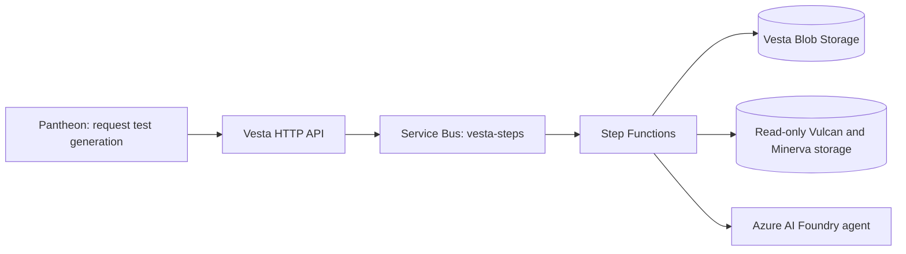

# Vesta

Vesta generates xUnit test cases for AI-generated C# mapping code. It reads a completed Vulcan job, the associated Minerva package and test cases (when available), and the project ZIP. It validates those inputs before they are used by the later generation workflow.

The MVP uses Azure AI Foundry for test generation. The validation and execution workflow is staged separately; this MVP does not execute tests in Azure.

## Architecture



Messages contain IDs, steps are idempotent, `job.json` uses ETags, other files are write-once, and every state change is audited.

## Inputs

Vesta consumes four logical inputs:

1. **Vulcan `job.json`** — identifies the job, mapping, origin, project, generation and output ZIP. The job must be in `Done` state and `output.compiled` must be `true`.
2. **Minerva package JSON** — contains exactly three package files, identified by their `Remarks` values as `source`, `target` and `mapping`. The mapping contract version currently accepted by the reader is `0.1`.
3. **Minerva test-cases JSON** — contains test cases associated with mapping rows. A missing test-cases document is allowed and is represented as no supplied cases.
4. **Vulcan project ZIP** — contains the generated project and its existing test-project structure. Vesta reads and validates the archive in memory.

See [Input handling and validation](docs/explained/inputs.md) for the current input contracts, checks and configured limits.

## Settings

| Setting | Default | Notes |
|---|---:|---|
| `VestaStorage__BlobServiceUri` | none | HTTPS URI; use a connection string locally |
| `VestaStorage__ConnectionString` | none | Local development only |
| `VestaStorage__JobsContainer` | `vesta-jobs` | Vesta-owned |
| `VestaStorage__OutputContainer` | none | Required |
| `VestaStorage__CreateContainersIfMissing` | `false` | Development only |
| `VulcanStorage__BlobServiceUri` | Vesta account | Optional override |
| `VulcanStorage__JobsContainer` | `vulcan-jobs` | Read-only |
| `VulcanStorage__OutputContainer` | `vulcan-output` | Read-only |
| `MinervaStorage__BlobServiceUri` | Vesta account | Optional override |
| `MinervaStorage__RunsContainer` | `runs` | Read-only |
| `ServiceBusConnection__fullyQualifiedNamespace` | none | Azure identity authentication |
| `ServiceBusConnection` | none | Local connection string |
| `ServiceBus__TopicName` | `vesta-steps` | Topic |
| `Foundry__ProjectEndpoint` | none | Required |
| `Foundry__VestaAgentName` | none | Required |
| `Foundry__VestaAgentVersion` | none | Required |
| `Agents__TimeoutSeconds` | `600` | Per call |
| `Check__MaxRepairRounds` | `2` | Range 0–5 |
| `Limits__MaxZipBytes` | `52428800` | 50 MiB |
| `Limits__MaxZipEntries` | `5000` | Maximum archive entries |
| `Limits__MaxZipUnpackedBytes` | `209715200` | 200 MiB |
| `Limits__MaxAgentInputBytes` | `1048576` | 1 MiB |
| `Limits__MaxTestFileBytes` | `262144` | 256 KiB |

The input limits are represented by the immutable `InputLimits` record. All five values must be greater than zero.

## Build

Run from the repository root with .NET SDK 10.0.100 or a later feature band:

```powershell
dotnet restore .\Company.ABC.Vesta.slnx
dotnet build .\Company.ABC.Vesta.slnx --no-restore
```

## Inspect

Run the sample checks from the repository root:

```powershell
dotnet run --project .\tools\Company.ABC.Vesta.Inspect -- check-samples
dotnet run --project .\tools\Company.ABC.Vesta.Inspect -- check-input-samples
```

`check-input-samples` creates its ZIP fixtures at runtime from the source fixtures under `samples/inputs/zips-src/`; binary ZIP fixtures do not need to be committed.

For local Functions development, install and start Azurite, copy `src/Company.ABC.Vesta.Functions/local.settings.sample.json` to `local.settings.json`, replace placeholders with local values, then run the Functions project. Never commit `local.settings.json` or real credentials.

> T1 establishes the foundation. Storage repositories, dependency health probes and job processing are wired in later steps; this foundation package intentionally does not claim those workflows are complete.
